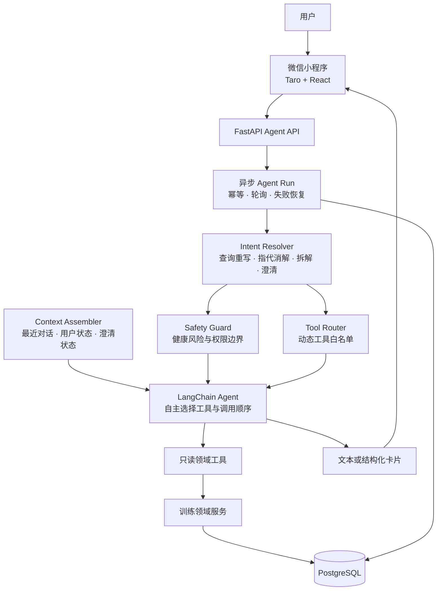

# Fitness Agent

日常开发、启动、测试和打包统一在本仓库根目录进行。`.tmp/` 下保留的候选工作区用于查阅历史证据或独立验证，不能替代主工作区。

- [项目文档](docs/README.md)：开发与部署导航。
- [当前状态](docs/current-status.md)：源码来源、发布状态、验收结果和待办的唯一入口。
- [运行指南](docs/getting-started.md)：本地环境与小程序配置。

在根目录核对当前工作区和版本：

```powershell
python scripts/check_workspace.py
```

本机已有虚拟环境时可用 `.\.venv\Scripts\python.exe` 替代 `python`。版本源为 `backend/VERSION`；API 和后端打包直接读取它，小程序 `package.json` 必须与之匹配。修改版本后运行 `python scripts/check_workspace.py --sync-version`，CI、微信构建和发布预检会检查一致性。版本号相同不代表源码相同，应同时核对 Git SHA 和 dirty 状态。

配置完成后，在根目录用 `docker compose up -d --build` 启动后端，在 `miniapp/` 用 `pnpm dev:weapp` 开发小程序；后端本地打包入口为 `.\scripts\package_cloudbase_backend.ps1`。具体命令与验收步骤见运行指南。

## 简介

Fitness Agent 是一个以微信小程序为入口的运动健康Agent，能够理解多轮上下文，并基于用户资料、训练计划和历史数据动态调用工具，提供个性化训练建议、饮食建议与调整提案。

## 架构



核心设计：

- **Intent Resolver** 负责意图拓展、指代消解、任务拆解和缺失信息澄清。
- **Tool Router** 根据当前意图生成最小工具白名单，不把固定场景绑定成固定流程。
- **LangChain Agent** 在白名单内自主决定是否调用工具、调用顺序以及何时停止。
- **领域服务** 是训练数据的唯一事实来源，模型不能直接访问数据库。
- **Safety Guard** 在模型调用前阻断健康高风险请求和未开放的写操作。
- **异步运行协议** 负责请求幂等、任务恢复和同一会话串行执行。

主要技术栈：Python 3.13、FastAPI、LangChain、DeepSeek、PostgreSQL、Taro、React、TypeScript。

开发、部署和评测入口见 [项目文档](docs/README.md)；版本与待办见 [当前状态](docs/current-status.md)。

> 本项目用于 Agent 架构与健身产品工程实践，不提供医疗诊断或治疗。
