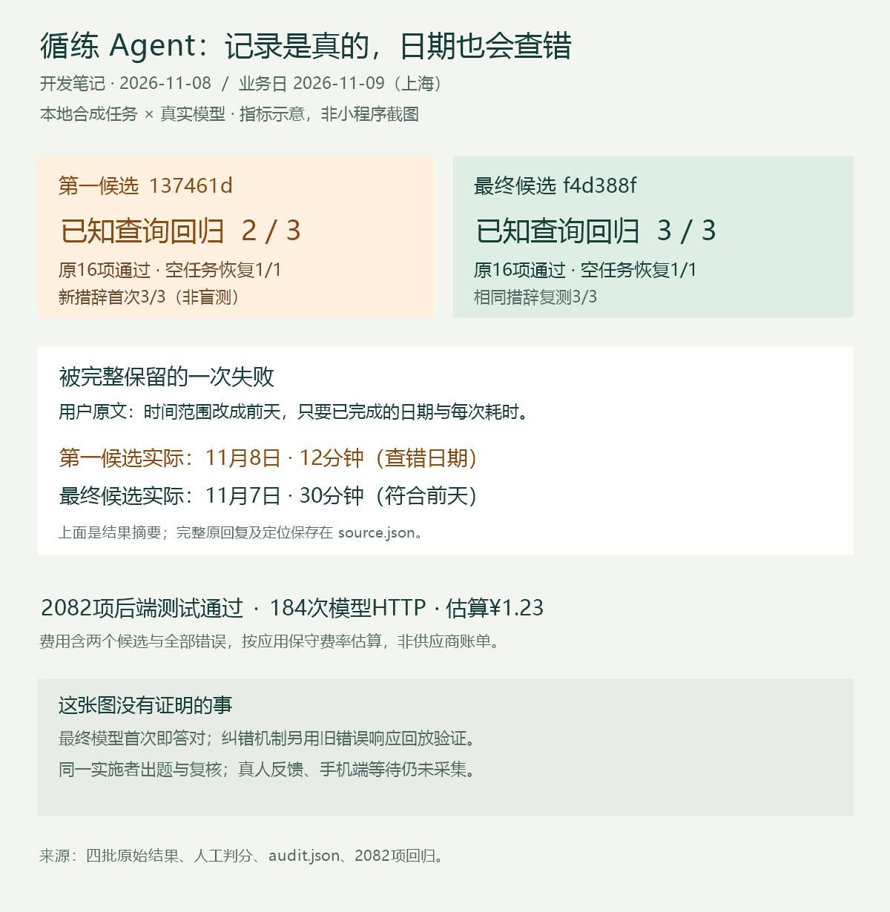

# 开发笔记：答得很像对的，日期也可能错一天

这轮先补一个历史查询问题。用户问“过去一周完成过的训练，每场日期和用了多少分钟”，模型已经识别为查询，本地规则却把“完成”当成写入命令。我们收窄了这个词在名词修饰中的判断，并把空任务状态明确交给模型，避免失败对话之后凭空续接一个不存在的任务。

第一候选的原16项任务全部完成，扩展测试却出现了另一个问题。业务日期是11月9日，用户把范围改成“前天”，模型展开成11月8日。后端照着这个日期，交付了12分钟的真实记录。回答很完整，查到的数据也是真的，但查错了那一天；正确结果应是11月7日、30分钟。因此这项只能记部分完成。

随后增加的是日期一致性检查：在已有来源的整段日期范围修订中，把明确日期或支持的相对天数与模型展开核对。发现冲突就使用已有的有限修复机会；反复出错则停止这次理解，不执行错误读取。这不是把所有日历表达都做成规则，周范围、复杂表达和多数首次查询仍有未覆盖部分。

最终候选的原16项与扩展7项都完成，后端2082项测试通过。整个过程184次模型HTTP，包含第一候选的错误，按应用保守费率估算约1.23元。原响应、工具轨迹、修改前代码和失败日志都有留档。

有一个容易夸大的地方：最终真实测试中，模型第一次就把日期算对了，所以这批成功不能证明新增纠错逻辑实际触发过。我们另用旧错误响应回放，确认错一次会修复，连续错误会被拒绝。真实任务结果和机制验证分开记录。

原题单轮终态等待P50，串行约4.86秒，并发2约7.28秒。这是本机TCP与单worker的小样本，含轮询，没有手机网络和微信渲染，不能当作上线体验承诺。出题和复核也是同一实施者，三种新措辞在最终候选中已经属于复测，不称盲测。

接下来要通过独立的正式发布门禁，部署同一份代码，再在手机上记录真实等待、纠正次数和任务完成情况。稿件此时仅本地准备，发布与手机数据尚未补齐。

素材来源：history-intent-release-20261108轮次记录、最终验收报告、assets/history-intent-release-20261108/source.json及其文件指纹。所有公开对话均为合成数据，配图为指标示意。
